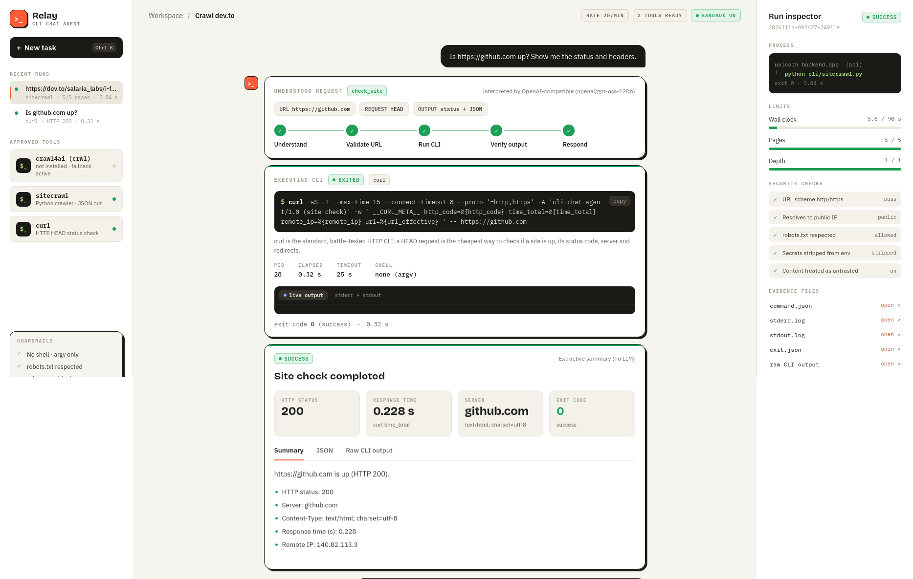
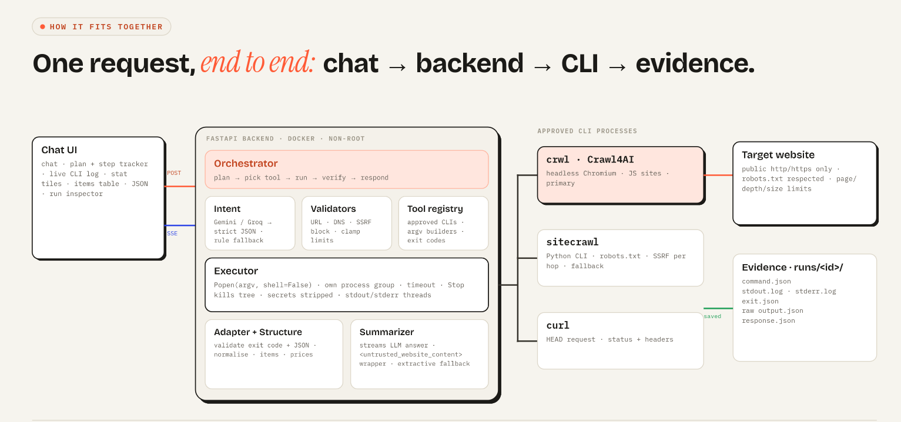
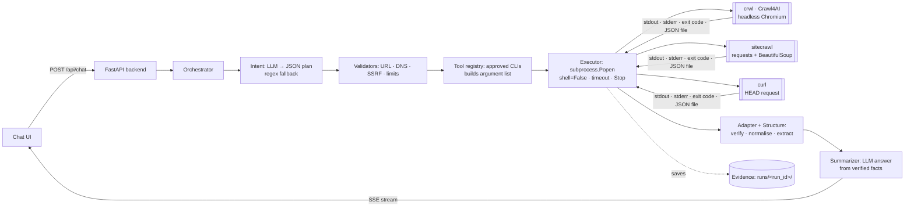
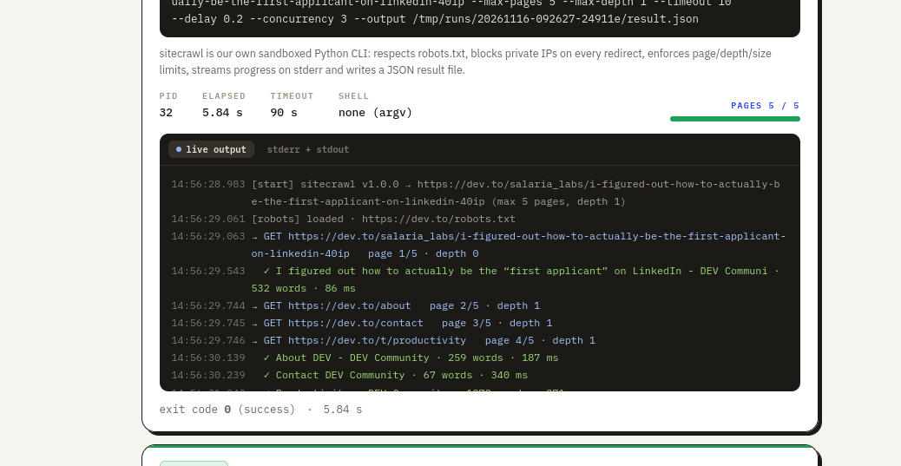
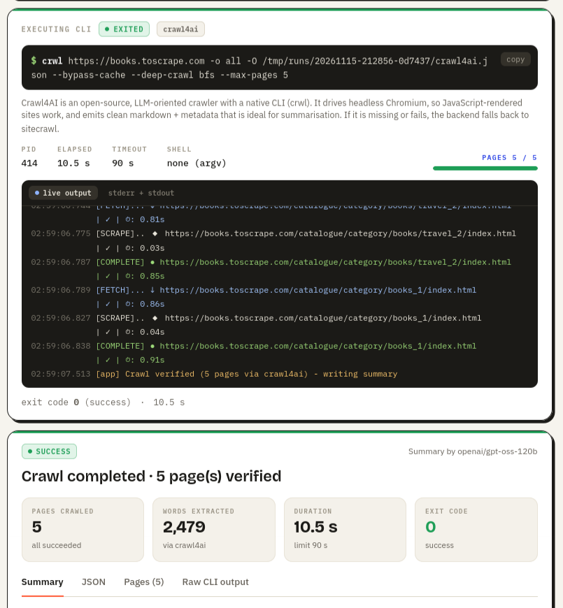
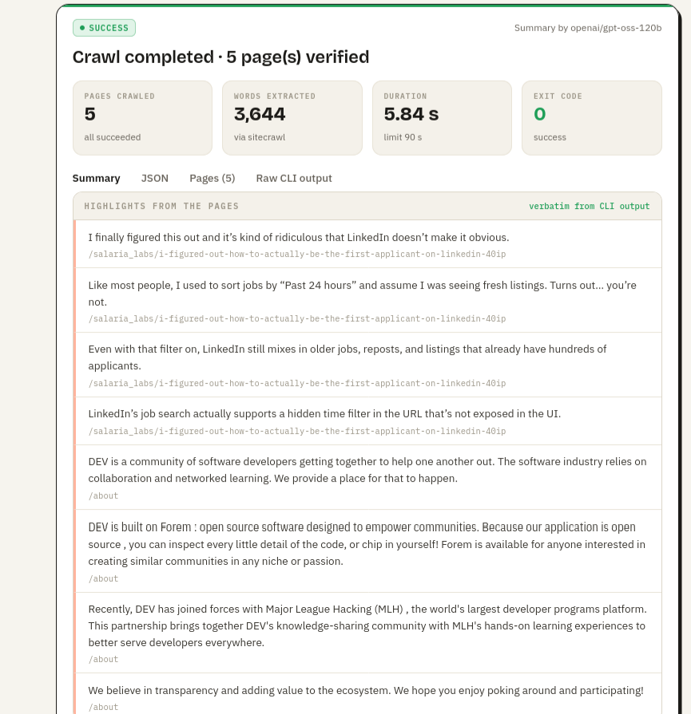
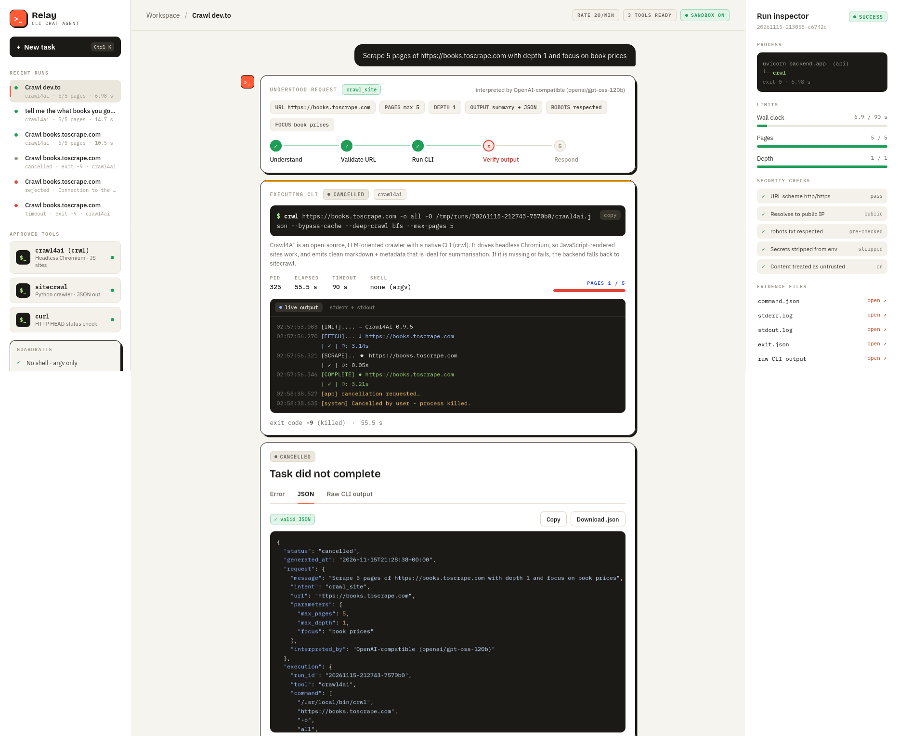
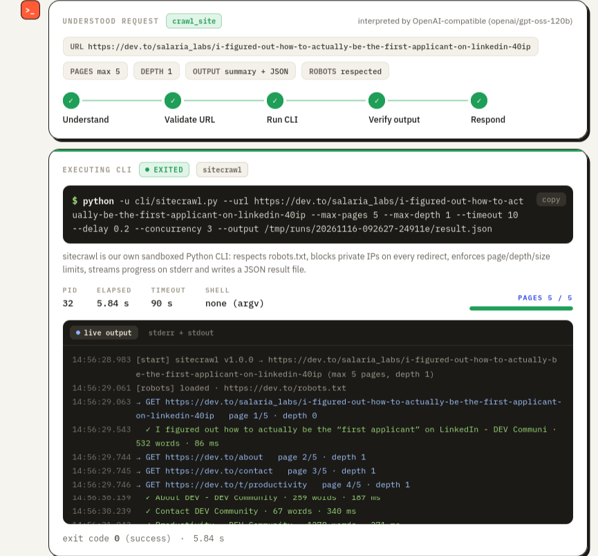

# Relay: a chat that doesn't just talk, it runs real CLI tasks

**Relay** is an AI chat application that understands a natural-language request, **runs an approved command-line tool on the backend**, captures exactly what happened (**stdout, stderr, exit code, output file**), verifies the result, and returns a **summary plus structured JSON** in the chat.

> BuildSprint Round 2: *CLI-Driven AI Chat Execution for Complex Tasks*

| | |
|---|---|
| 🎥 **Demo video** | https://www.youtube.com/watch?v=lT7gVd8AzAU |
| 🌐 **Live demo** | https://relay-cli-chat-agent.onrender.com *(free tier, so it may take ~50 s to wake up)* |
| 💻 **Run locally** | `docker run -p 8000:7860 --env-file .env --shm-size=1g relay` (see [Run locally](#5-run-locally)) |



---

## Contents
1. [What it does](#1-what-it-does)
2. [Architecture](#2-architecture)
3. [How a request flows, step by step](#3-how-a-request-flows-step-by-step)
4. [Screenshots](#4-screenshots)
5. [Run locally](#5-run-locally)
6. [Deploy](#6-deploy)
7. [Security](#7-security-and-responsible-execution)
8. [Response JSON](#8-response-json)
9. [Tests](#9-tests)
10. [Tech stack and AI disclosure](#10-tech-stack-and-ai-disclosure)
11. [Design notes and limitations](#11-design-notes-and-limitations)

---

## 1. What it does

| You type | What actually happens |
|---|---|
| *Crawl https://example.com, extract the important information, give me a summary, and return JSON* | The LLM turns the message into a JSON plan, the backend runs **`crwl https://example.com -o all …`** (Crawl4AI), streams its live output, checks the exit code and output file, and returns a summary plus valid JSON |
| *Scrape 8 pages of https://books.toscrape.com and focus on book prices* | A multi-page crawl. Code extracts **book names and prices**, computes lowest/highest/average, and shows an **items table built from CLI output, not by the AI** |
| *how many products are there?* | A follow-up with no URL: it reuses the site from the conversation and answers from the page |
| *Is https://github.com up?* | Runs **`curl -sS -I …`** (HEAD request) and shows the HTTP status, server and response time |
| *Run rm -rf / on the server* | **Refused.** There is no shell tool, and only approved tools can run |
| *Crawl https://no-such-domain.xyz* | **Rejected before any process starts**, with an honest error |

---

## 2. Architecture





**The architecture in one line:** the **AI understands** the request, a **real CLI process does the work**, and **code verifies** the result before the answer is streamed to the user.

---

## 3. How a request flows, step by step

Example request: *"Scrape 8 pages of books.toscrape.com and focus on prices"*

### Step 1: Chat UI
The user types the request. The browser sends it to the **FastAPI** backend and keeps the connection open, so every update streams back live through **Server-Sent Events (SSE)**: the plan, the command, each log line, the exit code, the summary and the final JSON.

### Step 2: Orchestrator
The controller. Every request follows the same fixed steps: **understand → check → run → verify → respond**.

### Step 3: Understanding the request (Intent)
The backend sends the message to the **LLM API** (Groq · `openai/gpt-oss-120b`; Gemini is also supported) and asks it to reply **only in JSON**:
```json
{ "intent": "crawl_site", "url": "https://books.toscrape.com", "max_pages": 8, "max_depth": 1, "focus": "prices" }
```
| Field | Meaning |
|---|---|
| `intent` | what the user wants: `crawl_site`, `check_site`, `chat`, or `unsupported` |
| `url` | the website mentioned |
| `max_pages` | how many pages to crawl |
| `max_depth` | how deep to follow links from the first page |
| `focus` | what the user cares about (prices, contacts…) |

**Rules:** the intent must be one of the 4 allowed values. The LLM **never writes a command**. It must not invent a URL (if none is given, the app asks for one). Requests to run commands, access files or hack are marked `unsupported` and refused. Pages are limited to 1–20 and depth to 0–2; larger values are reduced to the maximum. If the LLM is not available, **regex and keywords** read the same values from the message and build the same JSON.

### Step 4: Validators
Before anything runs, the URL must be **http/https** with no embedded credentials, the domain must **resolve in DNS**, and every resolved IP must be **public**. Private, loopback, link-local and the cloud metadata address `169.254.169.254` are blocked (**SSRF protection**). NAT64 and IPv4-mapped IPv6 addresses are decoded to the IPv4 address inside. If anything fails, **no process is started**.

### Step 5: Tool registry (the approved CLI tools)
Only three tools can ever run. For each one, the registry builds the command as a **list of separate arguments** from the validated JSON:

| Tool | Used for | Argument list (example) |
|---|---|---|
| **Crawl4AI** (`crwl`), primary | crawling websites, including JavaScript sites | `["crwl", URL, "-o", "all", "-O", "runs/<id>/crawl4ai.json", "--bypass-cache", "--deep-crawl", "bfs", "--max-pages", "8"]` |
| **sitecrawl**, fallback | lightweight crawling | `["python", "-u", "cli/sitecrawl.py", "--url", URL, "--max-pages", "8", "--max-depth", "1", "--timeout", "10", "--delay", "0.2", "--concurrency", "3", "--output", "runs/<id>/result.json"]` |
| **curl** | "is this site up?" checks | `["curl", "-sS", "-I", "--max-time", "15", "--connect-timeout", "8", "--proto", "=http,https", "-A", "...", "-w", "<status/time/ip>", "--", URL]` |

Each value sits in **its own slot**, so text from the user can never turn into an extra command.

**Why two crawlers?**
- **sitecrawl** uses Python **requests** to download the raw HTML and **BeautifulSoup** to parse it. It's fast and light, but it only sees the HTML the server sends, so pages built with JavaScript look almost empty.
- **Crawl4AI** opens the page in a **real headless Chrome** (Playwright), runs the JavaScript, waits for content, and converts the page to clean markdown for the LLM.
- Crawl4AI is heavier, so it runs **first**, and **sitecrawl takes over automatically** if Crawl4AI fails, returns bad output or times out. Both attempts are recorded in `execution.attempts`.

**curl flags:** `-I` sends a HEAD request (headers only, very fast), `--proto =http,https` allows only web protocols, `--max-time 15` caps the time, `-w` prints the status code, timing and IP, and `--` stops the URL being read as an option. Redirects are **not** followed, so curl can't be bounced to an internal host.

### Step 6: Executor, `subprocess.Popen` without a shell
The executor runs the argument list with Python's **`subprocess.Popen`**, which starts an operating-system command (like `crwl` or `curl`) as a **separate process** and keeps control of it while it runs.

```python
subprocess.Popen(argv, shell=False, stdin=DEVNULL, stdout=PIPE, stderr=PIPE,
                 cwd=run_folder, env=safe_env(), start_new_session=True)
```

**With a shell vs without a shell:**
```python
# ❌ shell=True: one text string, read by bash. ";" means "run another command"
subprocess.run(f"crwl {url}", shell=True)          # url = "x.com; rm -rf /"  → rm runs!

# ✅ shell=False: a list of arguments, no shell, ";" is just a character
subprocess.Popen(["crwl", url], shell=False)        # crwl receives one strange URL, rm never runs
```

While the tool runs, the executor:
- reads **stdout and stderr live** on two reader threads, which avoids pipe deadlocks, and streams each line to the chat
- enforces a **90-second timeout** and supports the **Stop** button. Both kill the **whole process tree** (process group / `taskkill /T`), so no orphan Chrome is left behind
- applies **CPU-time and 64 MB file-size limits** (Linux)
- **removes API keys** and any `*KEY*`, `*TOKEN*`, `*SECRET*` variables from the process environment
- saves the **exit code** and output file

**Why `Popen` and not `subprocess.run`?** `run` waits until the command finishes. `Popen` returns immediately, so we can stream logs live and kill the process on a timeout or Stop.

### Step 7: Verify and extract
When the process ends, the adapter checks the **exit code** (0 = success) and validates the **output JSON**. If something is wrong, the real error is shown, never a fake result. If it's valid, **code** (not the LLM) extracts the facts: titles, headings, **items with prices**, counts like "1000 results", contacts, and **price statistics**.

### Step 8: Summarize and stream the answer
The LLM writes a short answer **using only the extracted facts**. Website text is wrapped in `<untrusted_website_content>` tags, so a page can't instruct the AI, and the LLM's output is **display-only**: it can never trigger a tool. The answer streams to the chat word by word, followed by the stat tiles, the items table and the JSON.

### Step 9: Evidence
Every run is saved in `runs/<run_id>/`: `command.json`, `stdout.log`, `stderr.log`, `exit.json`, the raw CLI output, and `response.json`. Each file opens from the chat, so **every answer can be traced back to the real execution**.

---

## 4. Screenshots

**Plan + live CLI execution (sitecrawl on the deployed app)**: the exact command, PID, timeout, `shell=False`, the live log and the exit code.



**Crawl4AI run**: `crwl … --deep-crawl bfs` with Crawl4AI's own `[FETCH]/[SCRAPE]/[COMPLETE]` logs, then the verified result.



**Result with highlights**: stat tiles, plus text quoted verbatim from the CLI output (not generated by the LLM).



**Cancellation**: pressing ■ Stop kills the Crawl4AI process tree (exit code -9). The status is **CANCELLED**, and no result is claimed.



**Understood request + execution**: the LLM's plan (intent, URL, limits) followed by the sitecrawl command.



---

## 5. Run locally

**Prerequisites:** Docker, or Python 3.10+ and `curl`. You also need an LLM key: Groq is free at https://console.groq.com/keys (Gemini also works). The app works without a key in rule-based mode.

### Create `.env`
```env
LLM_PROVIDER=openai
OPENAI_API_KEY=gsk_your_key_here
OPENAI_BASE_URL=https://api.groq.com/openai/v1
OPENAI_MODEL=openai/gpt-oss-120b
LLM_REASONING_EFFORT=low
CRAWLER=auto
```

### Option A: Docker (recommended, includes Crawl4AI + Chromium)
```bash
docker build -t relay .
docker run --rm -p 8000:7860 --env-file .env --shm-size=1g -v "$PWD/runs:/tmp/runs" --name relay relay
# open http://localhost:8000
```
`--shm-size=1g` is needed by Chromium. To stop it: `docker stop relay`.

### Option B: Python
```bash
./run.sh          # macOS / Linux
run.bat           # Windows
# open http://localhost:8000
```
Optional, to add Crawl4AI with headless Chromium: `./install-crawl4ai.sh` (Arch is supported via pacman) or `install-crawl4ai.bat`. Without it, the app uses sitecrawl and says so.

### Use the crawler CLI by hand
```bash
python cli/sitecrawl.py --url https://example.com --max-pages 3 --output out.json
docker exec -it relay crwl https://example.com -o markdown
```

### Environment variables
| Variable | Default | Meaning |
|---|---|---|
| `LLM_PROVIDER` | `auto` | `openai` (any OpenAI-compatible API, e.g. Groq), `gemini`, or `none` |
| `OPENAI_API_KEY` / `OPENAI_BASE_URL` / `OPENAI_MODEL` | – | for Groq: `https://api.groq.com/openai/v1` with `openai/gpt-oss-120b` |
| `GEMINI_API_KEY` / `GEMINI_MODEL` | – / `gemini-2.5-flash` | alternative provider |
| `LLM_REASONING_EFFORT` | – | `low` / `medium` / `high` for reasoning models (`low` is fastest) |
| `CRAWLER` | `auto` | `auto` (Crawl4AI if installed, else sitecrawl), `crawl4ai`, or `sitecrawl` |
| `CRAWL4AI_FALLBACK` | `1` | fall back to sitecrawl if Crawl4AI fails |
| `CRAWL_MAX_PAGES` / `CRAWL_MAX_DEPTH` | `20` / `2` | hard limits |
| `PROCESS_TIMEOUT_S` | `90` | CLI wall-clock limit |
| `MAX_CONCURRENT_JOBS` | `3` | parallel CLI processes |
| `ALLOW_PRIVATE_HOSTS` | `0` | **local testing only**; keep at 0 |

---

## 6. Deploy

The live demo runs on **Render** (free web service, Docker).

1. Render → **New → Web Service** → connect this repo → Runtime **Docker** → Instance **Free**.
2. Add the environment variables from `.env` above, plus `CRAWLER=sitecrawl` and `WITH_CRAWL4AI=0`.
3. Deploy. Render sets `$PORT`, and the Dockerfile reads it.

> **Note:** the free tier has **512 MB RAM**, which isn't enough for Crawl4AI's headless Chrome (~2 GB recommended). So **the live demo uses the `sitecrawl` CLI**, and the sidebar honestly shows *"crawl4ai · not installed · fallback active"*. The full Docker image (local or on a ≥2 GB host) runs **Crawl4AI as the primary crawler**, as shown in the demo video.

---

## 7. Security and responsible execution

| Requirement | How Relay does it |
|---|---|
| No raw text in a shell | `subprocess.Popen(argv, shell=False)`: user and LLM text is only ever one argument value |
| Approved tools, validated inputs | allow-list of 3 CLIs · URL scheme, credentials, DNS checks · the server builds every file path |
| Least privilege / sandboxing | Docker non-root user · own process group · stdin closed · CPU and file-size limits |
| Timeouts and limits | 90 s per process · 10 s per request · ≤ 20 pages · depth ≤ 2 · 2 MB per page · 3 jobs · 20 req/min per IP |
| SSRF / internal network | private, loopback, link-local and metadata IPs blocked · NAT64 decoded · re-checked on every redirect (sitecrawl) |
| robots.txt | pre-checked before Crawl4AI · enforced by sitecrawl |
| Website content is untrusted | `<untrusted_website_content>` wrapper · LLM output is display-only · injection text flagged · HTML escaped in the UI |
| No secrets exposed | keys only in `.env` / the host's secret store · stripped from child processes · never in logs, chat or tracebacks |
| Honest status | `success` · `partial` · `failed` · `timeout` · `cancelled` · `blocked` · `invalid_input`: never claims success without evidence |

---

## 8. Response JSON
```json
{
  "status": "success",
  "request":   { "message": "...", "intent": "crawl_site", "url": "https://books.toscrape.com",
                 "parameters": { "max_pages": 8, "max_depth": 1, "focus": "prices" },
                 "interpreted_by": "OpenAI-compatible (openai/gpt-oss-120b)" },
  "execution": { "run_id": "...", "tool": "crawl4ai", "command": ["crwl", "https://books.toscrape.com", "-o", "all", "..."],
                 "exit_code": 0, "exit_meaning": "success", "duration_ms": 10500, "timed_out": false, "cancelled": false,
                 "attempts": [{ "tool": "crawl4ai", "exit_code": 0, "outcome": "success" }] },
  "summary":   { "text": "...", "key_points": ["..."], "site_type": "e-commerce", "focus_findings": "...", "generated_by": "llm" },
  "data":      { "site": { "name": "...", "emails": [], "phones": [] },
                 "stats": { "pages_crawled": 5, "pages_failed": 0, "total_words": 2479 },
                 "extracted_items": [{ "name": "Tipping the Velvet", "price": "£53.74", "price_value": 53.74, "details": "In stock", "page": "..." }],
                 "price_stats": { "items_with_price": 20, "min": 10.0, "max": 59.99, "average": 34.5 },
                 "pages": ["..."], "errors": [] },
  "error": null
}
```

---

## 9. Tests
```bash
docker run --rm relay python -m pytest -q -p no:cacheprovider
```
25+ offline tests (a local fixture website plus a fake `crwl` binary) covering:
- **argv safety** and **secret stripping** from the child environment
- **SSRF blocking**, including NAT64 / IPv4-mapped addresses
- a **real timeout kill** and **real cancellation**
- the Crawl4AI **crash, bad-output and timeout fallback** to sitecrawl
- **listing extraction** (items and prices), with **no fake phone numbers** from year ranges
- **follow-up context** and the **LLM path** (mocked, including a model trying to inject a command)

---

## 10. Tech stack and AI disclosure
- **Backend:** Python 3.12 · FastAPI · Uvicorn · Server-Sent Events · `subprocess`
- **CLI tools:** Crawl4AI (`crwl`, Playwright headless Chromium) · `sitecrawl` (requests + BeautifulSoup4) · `curl`
- **Frontend:** HTML / CSS / JavaScript (no build step) · UI designed in **Penpot**
- **LLM at runtime:** Groq `openai/gpt-oss-120b` (or Google Gemini) for intent parsing and streamed summaries, with a regex fallback
- **Deployment:** Docker (non-root) · Render
- **AI assistance:** **Claude (Anthropic)** was used as a coding and design assistant. I reviewed, ran and tested the implementation and can explain every component.

---

## 11. Design notes and limitations
**Changes from the Round 1 proposal:** the architecture is the one proposed (Gemini/LLM layer → orchestration → process executor → Crawl4AI CLI → structured output → Docker). Two implementation choices changed:
- **Python + FastAPI instead of Node.js + Express:** Crawl4AI, the fallback crawler and the backend share one language, which keeps process control simple. Framework overhead is under 1% of response time.
- **Plain HTML/JS instead of React:** no build step, so the app runs with one command.

**Limitations and next steps:**
- Links that Crawl4AI follows inside a deep crawl aren't re-checked against private IPs by us (the start URL is). Run on an egress-restricted network in production.
- The free live demo can't run Chromium (512 MB). A host with ≥ 2 GB RAM can run the full image.
- Future work: more approved tools (PDF extraction, sitemap parsing, Lighthouse audits), and stronger sandboxing (gVisor or a separate container per run).
