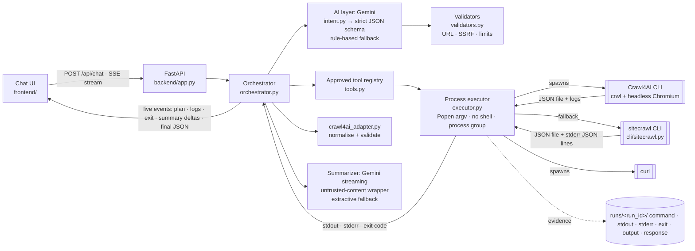

# Relay: a CLI-driven AI chat that runs real tasks

**Relay** is a chat app that understands natural-language requests and **runs real CLI processes on the backend** to do the work. The main demo is website crawling. You give it a URL, Gemini works out the task, and the backend runs the **Crawl4AI CLI (`crwl`)** in headless Chromium. If Crawl4AI is unavailable, our own **`sitecrawl`** CLI takes over. The backend captures **stdout, stderr, the exit code and the JSON output file**, checks the result, and the chat shows a **streamed summary plus structured JSON**. You can watch the command, the process ID and the live log while it runs.

> BuildSprint Round 2: *CLI-Driven AI Chat Execution for Complex Tasks*

---

## 1. What it does

| You type | What actually happens |
|---|---|
| "Crawl https://example.com, extract the important information, give me a summary, and return JSON" | Gemini maps the request to `crawl_site` and the URL is validated. The backend spawns `crwl https://example.com -o all -O runs/<id>/crawl4ai.json --bypass-cache` (or `python cli/sitecrawl.py …`) and streams its output live. It then checks the exit code, validates and normalises the JSON, streams a summary, and returns the structured JSON |
| "Scrape 8 pages of https://books.toscrape.com and focus on prices" | Same flow as a multi-page crawl (`--deep-crawl bfs --max-pages 8`), with a *focus* section in the summary |
| "Is https://github.com up? Show headers" | Runs `curl -sS -I --max-time 15 --proto =http,https -- <url>` and parses the status line and headers into JSON |
| "Run rm -rf / on the server" | **Refused.** There is no shell tool, and only approved tools can run |
| "Crawl ftp://files.example.com" or a domain that doesn't exist | **Rejected before any process starts**, with an honest reason |

## 2. Architecture



How this maps to the brief's pseudocode:

```python
task    = intent.parse(prompt) + validate_url(url)           # validate_user_request
process = executor.run(TOOLS["crawl4ai"], task.params, job)   # start_approved_cli (falls back to "crawl_site")
stdout, stderr, exit_code = <reader threads + proc.wait()>     # collect_process_output
result  = orchestrator._load_result(spec, end)                # validate_and_parse (exit code + JSON shape)
reply   = summary (streamed) + JSON envelope                   # format_chat_response
```

### Project layout
```
relay-cli-chat-agent/
├── cli/sitecrawl.py          # our crawler CLI (fallback + also usable by hand)
├── backend/
│   ├── app.py                # FastAPI: /api/chat (SSE), /api/cancel, /api/runs, /api/health
│   ├── orchestrator.py       # plan → crawler chain (crawl4ai → sitecrawl) → validate → respond
│   ├── intent.py             # NL → TaskPlan (Gemini with strict schema, rule-based fallback)
│   ├── validators.py         # URL validation, SSRF protection, clamping
│   ├── tools.py              # APPROVED tool registry: argv builders, timeouts, exit-code meanings
│   ├── executor.py           # subprocess runner: live capture, timeout, cancel, process-tree kill, limits
│   ├── crawl4ai_adapter.py   # converts Crawl4AI output into our schema (defensive)
│   ├── summarizer.py         # streaming LLM summary with untrusted-content wrapper / extractive fallback
│   ├── llm.py                # Gemini + any OpenAI-compatible API over HTTPS (incl. streaming)
│   └── config.py             # env-var configuration
├── frontend/                 # index.html · app.js · style.css (no build step)
├── tests/                    # 18 pytest tests + local fixture website + fake `crwl`
├── Dockerfile  .dockerignore  requirements.txt  requirements-crawl4ai.txt
├── run.bat / run.sh                      # one-command local start
└── install-crawl4ai.bat / .sh            # optional: Crawl4AI + Chromium
```

## 3. The CLI layer (the core of the challenge)

### Which CLIs, and why
| Tool | Binary | Why |
|---|---|---|
| `crawl4ai` (primary) | `crwl` | An open-source, LLM-oriented crawler with a **native CLI**. It drives **headless Chromium**, so JavaScript-rendered sites work, and it outputs clean markdown and metadata that are ideal for summarising. We call it with `-o all -O <file>` because `-o json` only prints `extracted_content`, which needs an extraction schema. |
| `crawl_site` (fallback) | `python cli/sitecrawl.py` | Our own small crawler (requests + BeautifulSoup) with strict safety: robots.txt, an SSRF check on **every redirect**, page/depth/size/time limits, parallel fetching, **JSON-lines progress on stderr**, a JSON result file and meaningful exit codes (`0` ok, `2` invalid input, `3` unreachable, `4` blocked by robots.txt, `5` internal error). It needs nothing extra installed. |
| `check_site` | `curl` | The standard HTTP CLI. A `HEAD` request is the cheapest uptime and headers check. |

**Crawler chain:** `CRAWLER=auto` (the default) uses Crawl4AI if `crwl` is installed. If it crashes, exits non-zero or produces output that can't be parsed, the backend **automatically runs `sitecrawl`**. The UI and the JSON show both attempts, e.g. `execution.attempts: [crawl4ai (failed), crawl_site (partial)]`, so nothing is hidden.

### How inputs reach the CLI
1. Gemini can only choose a tool **name** from an allow-list (`crawl_site`, `check_site`, `chat`, `unsupported`) plus typed fields. Any extra fields it returns, such as a "command", are ignored.
2. The URL is validated: http/https only, no credentials, no whitespace, the DNS name must resolve, and private/loopback/link-local IPs (including `169.254.169.254`) are blocked. Numbers are clamped to server limits.
3. `tools.py` builds an **argv list** and `subprocess.Popen(argv, shell=False)` runs it. Text like `https://a.com/;rm -rf /` arrives as one literal argument (there's a test for this).

### How output is captured
* stdout and stderr are each read line by line on their own reader threads, **streamed live** to the browser over Server-Sent Events, and saved in full to `runs/<run_id>/stdout.log` and `stderr.log`.
* The exit code is mapped to a meaning. `command.json`, `exit.json`, the raw output (`result.json` or `crawl4ai.json`) and the final `response.json` are saved as evidence and can be opened from the chat and from the Run inspector.

### Long-running tasks, timeouts, cancellation, failures
* **Process timeout** (`PROCESS_TIMEOUT_S`, default 90 s). The **whole process tree is killed** (POSIX process group, or `taskkill /T` on Windows), so headless Chromium can't be left running.
* **■ Stop** calls `POST /api/cancel/<run_id>`, which also kills the process tree.
* On Linux/Docker, the child process gets **CPU-time and file-size limits** (`RLIMIT_CPU`, `RLIMIT_FSIZE`).
* Inside the CLIs: a 10 s timeout per request, at most 5 redirects, 2 MB per page, and caps of 20 pages / depth 2.
* At most 3 tasks run at once, and requests are limited to 20 per minute per IP.
* **Failure honesty:** if the exit code isn't 0, the JSON is invalid, or no page was crawled, the response is marked `failed` / `blocked` / `invalid_input` / `timeout` / `cancelled` and **no data is shown as if it were real**. Partial crawls are labelled `partial`, with the failed URLs listed.

## 4. Security and responsible execution
| Risk | Mitigation |
|---|---|
| Shell injection | No shell: argv lists, `shell=False`, approved tools only, and the model never writes commands |
| SSRF / internal network | DNS-resolved IPs are checked before any process starts. `sitecrawl` re-checks every redirect hop. Private, reserved and metadata ranges are blocked |
| Prompt injection from websites | Page text is wrapped in `<untrusted_website_content>` and the model is told to treat it as data. Its output is display text only and can never trigger a tool. Instruction-like text is **detected and flagged** in the UI |
| Secrets | Keys come only from `.env` or the host's secret store and are sent only in provider request headers. **Every `*KEY*`, `*TOKEN*`, `*SECRET*` variable is removed from the child process environment.** Errors contain no tracebacks, and cookies are never echoed |
| XSS from crawled content | All website-derived text is HTML-escaped in the UI |
| Least privilege | The Docker image runs as a non-root user. Child processes get stdin closed, their own working directory, and resource limits |
| Respecting sites | robots.txt is honoured (`sitecrawl` itself; a pre-flight check before Crawl4AI), with an identifiable User-Agent and a politeness delay |

Known limitation: links that Crawl4AI follows inside a deep crawl aren't re-checked against private IPs by us. Only the start URL is. `sitecrawl` checks every hop. In production, run the container on an egress-restricted network.

## 5. Run locally

**Prerequisites:** Python 3.10+ and `curl` (built into Windows 10+, macOS and Linux). A Gemini key is optional but recommended (free at https://aistudio.google.com/apikey).

```bash
# 1. unzip / clone, then from the project folder:
run.bat            # Windows  (creates .venv, installs deps, copies .env.example → .env, starts server)
./run.sh           # macOS / Linux

# 2. open http://localhost:8000
```

Then add your key: open `.env`, set `GEMINI_API_KEY=...`, and restart. Without a key, everything still works using the rule-based intent parser and extractive summaries.

**Optional: enable Crawl4AI** (headless Chromium, about 300 MB download, run once):
```bash
install-crawl4ai.bat      # Windows
./install-crawl4ai.sh     # macOS / Linux
```
On **Arch Linux** the script installs Chromium's libraries with `pacman` instead of `apt` (Playwright's `--with-deps` only supports apt). Restart the app. The sidebar will show **crawl4ai (crwl)** with a green dot. If it isn't installed, the app uses `sitecrawl` automatically and says so.

**Manual setup** (instead of the scripts):
```bash
python -m venv .venv
.venv\Scripts\activate            # Windows   |   source .venv/bin/activate  (macOS/Linux)
pip install -r requirements.txt
copy .env.example .env            # Windows   |   cp .env.example .env
python -m uvicorn backend.app:app --port 8000
```

**Run the crawler CLI by hand:**
```bash
python cli/sitecrawl.py --url https://example.com --max-pages 3 --output out.json
crwl https://example.com -o markdown          # if Crawl4AI is installed
```

**Tests:** `pytest -q`. There are 18 tests and no internet is needed. They cover validation, intent parsing, argv safety, secret stripping, the CLI directly, end-to-end crawls, the curl check, unreachable hosts, a real **timeout kill**, real **cancellation**, the LLM path (mocked), streaming summaries, and Crawl4AI success, crash fallback and broken-output fallback (using a fake `crwl`).

### Environment variables (`.env`)
| Variable | Default | Meaning |
|---|---|---|
| `LLM_PROVIDER` | `auto` | `gemini`, `openai` (any OpenAI-compatible API: OpenAI, Groq, OpenRouter, Ollama), `none`, or `auto` |
| `GEMINI_API_KEY` / `GEMINI_MODEL` | – / `gemini-2.5-flash` | Gemini settings |
| `OPENAI_API_KEY` / `OPENAI_BASE_URL` / `OPENAI_MODEL` | – | OpenAI-compatible settings. **Groq:** `https://api.groq.com/openai/v1` with `openai/gpt-oss-120b` (or `openai/gpt-oss-20b`) |
| `LLM_REASONING_EFFORT` | – | `low` / `medium` / `high` for reasoning models such as Groq GPT-OSS (`low` = fastest) |
| `CRAWLER` | `auto` | `auto` (Crawl4AI if installed, otherwise sitecrawl), `crawl4ai`, or `sitecrawl` |
| `CRAWL4AI_FALLBACK` | `1` | Fall back to sitecrawl if Crawl4AI fails |
| `INTENT_FAST_PATH` | `0` | Set to `1` to skip the intent LLM call for unambiguous requests (about 1 s faster) |
| `CRAWL_MAX_PAGES` / `CRAWL_MAX_DEPTH` | 20 / 2 | Hard caps |
| `PROCESS_TIMEOUT_S` | 90 | CLI wall-clock limit |
| `MAX_CONCURRENT_JOBS` | 3 | Parallel CLI processes |
| `ALLOW_PRIVATE_HOSTS` | 0 | **Local testing only** (lets you crawl 127.0.0.1) |

### How to test the demo
1. Click **Crawl & summarise**. Watch the plan and step tracker, the exact command with its PID, the live log, the exit code, the streamed summary, the stat tiles, and the JSON tab.
2. Open **Raw CLI output** and the Run inspector's evidence files to see the run's evidence.
3. Try **Multi-page scrape**, then press **■ Stop** midway to see cancellation.
4. Try **Unreachable domain** and **Blocked command** for the error and safety states.

## 6. Deploy (Docker)

The `Dockerfile` builds one container with Python 3.12, the app, **Crawl4AI and headless Chromium**, `sitecrawl` and `curl`. It runs as a non-root user on port 7860 (or `$PORT`).

### Option A: Hugging Face Spaces (free, no card, 16 GB RAM, recommended)
1. On huggingface.co, go to **New Space**, name it `relay`, and set **SDK: Docker** (blank) and **CPU basic (free)**.
2. Upload the project (**Files → Upload files**, without `.env`) or push with git:
   ```bash
   git remote add space https://huggingface.co/spaces/<username>/relay
   git push space main      # password = a Hugging Face access token
   ```
3. Go to **Settings → Variables and secrets → New secret** and add `GEMINI_API_KEY`.
4. The build takes about 8–12 min (Chromium is large). The app will be at `https://<username>-relay.hf.space`.

The README front-matter (`sdk: docker`, `app_port: 7860`) tells Hugging Face how to run it.

### Option B: Render.com (free, from GitHub)
Go to **New → Web Service**, pick the repo, and set **Runtime: Docker**. Add `GEMINI_API_KEY`. The free tier has 512 MB, which is too small for Chromium, so under **Docker build args** set `WITH_CRAWL4AI=0` (the app then uses sitecrawl). The free tier sleeps when idle, so the first request takes about 50 s.

### Local container
```bash
docker build -t relay .
docker run -p 7860:7860 -e GEMINI_API_KEY=your_key relay    # open http://localhost:7860
```

## 7. Response JSON shape
```json
{
  "status": "success | partial | failed | timeout | cancelled | blocked | invalid_input",
  "request":   { "message": "...", "intent": "crawl_site", "url": "...", "parameters": {"max_pages": 5, "max_depth": 1, "focus": null}, "interpreted_by": "Gemini (gemini-2.5-flash)" },
  "execution": { "run_id": "...", "tool": "crawl4ai", "command": ["crwl", "https://example.com", "-o", "all", "..."], "exit_code": 0, "exit_meaning": "success", "duration_ms": 2140, "timed_out": false, "cancelled": false,
                 "attempts": [{"tool": "crawl4ai", "exit_code": 0, "outcome": "success"}] },
  "summary":   { "text": "...", "key_points": ["..."], "site_type": "reference", "focus_findings": null, "suspicious_content_detected": false, "generated_by": "llm" },
  "data":      { "crawler": "crawl4ai", "site": {"name": "...", "description": "...", "emails": [], "phones": [], "social_links": []},
                 "stats": {"pages_crawled": 1, "pages_failed": 0, "total_words": 28}, "pages": [ ... ], "errors": [] },
  "error": null
}
```

## 8. Design notes: how this evolved from the Round 1 proposal
The architecture is the one we proposed: Gemini AI layer, then orchestration, then process executor, then the Crawl4AI CLI, then structured output, packaged in Docker. Two implementation choices changed:
* **Python + FastAPI instead of Node.js + Express.** Crawl4AI, our fallback crawler and the backend now share one language and one dependency set, which made the process control code (process groups, resource limits, reader threads) simpler. The framework is under 1% of response time, so the bottlenecks are the crawl and the LLM, and both are streamed.
* **Plain HTML/JS instead of React.** There's no build step, so the judges can run it with one command. It's still a streaming chat UI with a run inspector, JSON export and a pages table.
* **Added a fallback crawler** (`sitecrawl`) so the demo never depends on a headless browser being installed.

## 9. Tech stack and AI disclosure
* **Backend:** Python 3, FastAPI, Uvicorn, Server-Sent Events, `subprocess`
* **CLI tools:** Crawl4AI (`crwl`, Playwright/Chromium), `sitecrawl` (requests + BeautifulSoup4), `curl`
* **Frontend:** HTML/CSS/JavaScript. Fonts: Bricolage Grotesque, IBM Plex Sans/Mono, Instrument Serif. UI designed in Penpot.
* **LLM at runtime:** Google Gemini for intent parsing and the streamed summary (any OpenAI-compatible model also works). A rule-based / extractive fallback is built in.
* **AI assistance during development:** Claude (Anthropic) was used as a coding and design assistant for parts of the code, tests, docs and the Penpot UI design. I reviewed, ran and tested the implementation and can explain every component.

## 10. Limitations and next steps
* Re-check every link Crawl4AI follows against the SSRF guard (for example via a filtering proxy).
* More approved tools (PDF text extraction, sitemap parsing, Lighthouse audits), each with its own validated argv builder.
* Stronger isolation: run CLIs in a separate container or gVisor sandbox with egress filtering.
